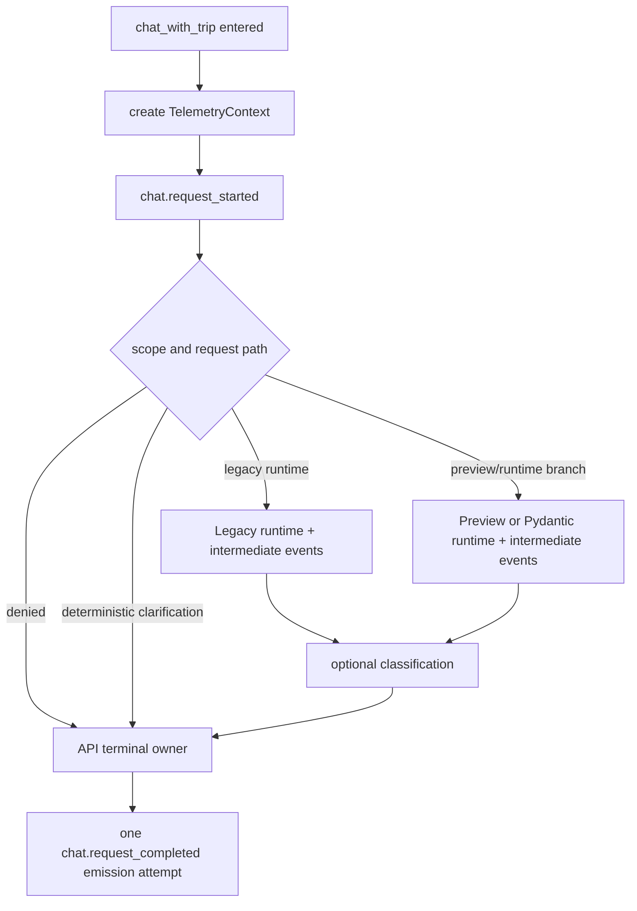

# Cadensy — PR-06A Phase B.1

## Independent Review Findings Resolution & Contract Freeze

**Status:** `PHASE B — READY FOR IMPLEMENTATION REVIEW`
**Scope:** design only. This document authorizes no code, infrastructure, CI, AWS, deployment, or business-behaviour change.

## 1. Decision and non-goals

PR-06A adds a privacy-safe, correlation-correct telemetry contract for the Trip Chat agent path. It must answer operational questions without serializing a prompt, conversation history, model text, tool arguments/results, member identity, trip identifier, exception text, provider body, or stack trace.

The implementation target is the production Trip Chat request path only:

- `POST /api/trips/{trip_id}/chat`, its legacy runtime branch, and the enabled preview/runtime branch;
- the Legacy agent runtime and Pydantic runtime at their existing runtime seams;
- read-only domain classification invoked by those paths.

It does **not** migrate unrelated `call_model` consumers (planner/explainer/etc.) into end-to-end request correlation. Its existing raw exception `print` is a privacy finding and must be changed to a safe fixed-field log in the PR, but it must not be represented as complete PR-06A coverage. Runtime selection remains owned by `runtime_factory`; no provider topology, routing, fallback behaviour, deadline, persistence, or response behaviour changes are allowed.

AWS task-definition/log-retention facts are documentation-only at this stage. Actual CloudWatch delivery, retention, and task configuration are **Needs Verification** by an authorized read-only AWS check; they are not assumptions in this contract.

## 2. Review findings resolved

| Finding | Frozen correction |
| --- | --- |
| B1 — legacy `trace.record_agent_round` is also an in-memory contract | Split safe in-memory round-summary construction from telemetry emission. `AgentRunResult.rounds` remains a sequence of compatible, safe summaries; telemetry never reuses the returned event object. |
| B2 — “model call” could overclaim physical provider attempts | The contract observes an invocation crossing Cadensy’s wrapper seam, not an HTTP attempt. SDK-internal retries are explicitly unobserved. Mock/fake calls carry a distinct source. |
| B3 — tool semantics were incomplete | One tool event represents one requested-tool dispatch conclusion, with closed statuses for guard, unknown, cache, execution, error, and deadline paths. It never includes arguments, results, or guard wording. |
| B4 — two terminal events were possible | Only the API route lifecycle owns `chat.request_started` and `chat.request_completed`; services, runtimes, preview, and classification emit no terminal event. |
| B5 — late provider completion and consumed response were conflated | Provider invocation outcome, request deadline, worker cancellation, late completion, and application result consumption are separate facts and separate fields/events. |
| B6 — old trace functions can leak raw values | Legacy JSONL/stdout persistence is retired from the agent path before the new emitter is enabled. Compatibility summaries stay in memory only. |
| B7 — schema fields/statuses were inconsistent | This document freezes a versioned envelope, event-specific schemas, nullable policy, enums, and failure normalization. |
| B8 — tests did not prove all claims | The implementation plan includes deterministic unit/integration tests, a log-capture privacy suite, and explicit negative assertions. No AWS/CI claim is made without verification. |

### PR-06A.1 contract corrections

- **Capacity is admission, not a deadline.** `AgentExecutionCapacityExceeded` maps to the separate closed `agent.capacity_rejected` event; it must not be emitted as `agent.deadline_exceeded` with request scope.
- **Unknown model-supplied tool names are never copied.** `unknown_tool` uses `tool_name=null` in both typed events and privacy-safe round summaries.
- **Pre-handler dispatch failures are distinct from handler failures.** `dispatch_failed` means no handler executed (for example, guard evaluation or preparation failed); `handler_failed` requires `handler_executed=true`.

## 3. Correlation and ownership contract

### 3.1 Identifiers

The API route creates one `TelemetryContext` immediately after FastAPI has entered `chat_with_trip` and before `_require_scoped_trip`:

```text
request_id   one UUID/opaque ID per entered Trip Chat handler
trace_id     one UUID/opaque ID per agent execution; null before a runtime exists
execution_id one UUID/opaque ID per bounded execution; null for deterministic paths
```

`RuntimeRequest.request_id` is supplied from this context, not created independently. The legacy runtime’s current independent `call_agent` trace ID must be replaced by/injected from the context so that request, execution, and trace do not drift. The Pydantic runtime uses the same context IDs. IDs are opaque correlation values only; no user, membership, trip, item, message, or model data may be encoded in them.

`TelemetryContext` is passed explicitly through route → service/preview → runtime → bounded execution. No `ContextVar`, global mutable state, request-local storage, or reconstructed IDs are permitted.

### 3.2 Request boundary

The accepted boundary for v1 is a successfully routed and dependency-admitted invocation of `chat_with_trip`.

- Authentication/dependency failures that prevent entry to the handler have no v1 Chat telemetry event.
- Once the handler starts, `chat.request_started` is emitted before trip-scope authorization. Scope denial therefore receives exactly one start and one terminal attempt.
- Framework body-validation failures before the handler are out of scope.
- The terminal owner emits exactly one **in-process emission attempt** in `finally`. Process termination, a hard kill, or sink failure cannot promise delivery or exactly-once persistence.

The terminal owner must not add a broad catch that changes existing HTTP exception mapping. It records a closed, safe terminal category, re-raises the original exception, and emits from `finally`.



`service.py`, `preview_apply.py`, either runtime, execution callbacks, and classification are forbidden from emitting `chat.request_completed`.

## 4. Event transport and privacy boundary

All PR-06A events are created by a single `SafeTelemetryEmitter` whose public input is typed, allow-listed event data. It serializes a JSON object to the approved application logger/stdout path only. The emitter:

1. accepts no `Exception`, `dict[str, Any]`, arbitrary payload, prompt, response, tool input/output, or user/domain object;
2. validates event name, enum values, identifier shape, and numeric bounds before serialization;
3. catches all sink/serialization failures internally and returns no failure to the business path;
4. writes one compact JSON line; it never writes a second diagnostic containing an exception representation;
5. has no direct filesystem JSONL output in the request path.

`trace.record_agent_round`, `trace.record_model_call`, and `trace.record_agent_lifecycle` currently print and/or write legacy JSONL. Before PR-06A events are enabled for Trip Chat:

- raw-field persistence by those functions is removed/disabled for this path;
- `record_agent_round` becomes (or delegates to) a pure safe summary builder returning the compatibility shape below, with no stdout/JSONL side effect;
- `record_model_call` is not used as a telemetry transport and cannot print stored failure reasons;
- lifecycle callers use the central safe emitter, including future callbacks;
- `call_model`’s `print(...{exc!r})` is replaced by a fixed event/log with a normalized category and no exception text.

`_redact_agent_trace` is not accepted as a telemetry privacy control. It may remain for existing in-memory application/provenance behaviour unless separately assessed, but none of its output may be passed to `SafeTelemetryEmitter`.

## 5. B1 — legacy `AgentRunResult.rounds` compatibility

`AgentRunResult.rounds` is a functional, in-memory result: the legacy runtime counts it; tests read `requested_tool`, `guard_rejected`, and `guard_limit_exceeded`; the real-tool trace script reads it. It must not become a logging side effect or lose these fields.

Freeze the return type as a safe summary built independently of telemetry:

```text
AgentRoundSummary (dict-compatible during migration)
  round_index: positive int
  requested_tool: bool
  tool_name: approved tool name | null
  guard_rejected: bool
  guard_limit_exceeded: bool
  tool_dispatch_status: enum | null
```

No summary contains tool arguments, tool results, guard reason, provider response, exception text, prompt, history, user data, or token object. Existing callers retain their fields and `len(rounds)` semantics. Any compatibility fields not listed above must be reviewed against all consumers before removal; the initial migration should retain only existing safe booleans/indices plus the new status.

The raw/internal tool result required for current agent execution remains local to `call_agent` and is not derived back from the summary. Telemetry emission receives its own typed facts and does not mutate, return, or serialize `rounds`.

## 6. B2 — exact model invocation meaning

### 6.1 Terms

| Term | Meaning | Guaranteed by v1? |
| --- | --- | --- |
| Logical legacy agent round | One top-loop iteration in `call_agent`. | Yes, legacy only. |
| Observed model invocation | One execution crossing Cadensy’s model wrapper seam. Legacy: one configured-provider invocation in `_agent_reply_with_fallback`; Pydantic: one `_DeadlineBoundModel.request` call. | Yes. |
| SDK/internal retry | An HTTP/retry action performed inside a provider SDK/wrapped Pydantic model. | No; intentionally unobserved. |
| Physical network attempt | A provider-side request/attempt. | No; not inferred. |

`agent.model_call_completed` means the observed wrapper invocation returned or raised. It must not be labeled a physical attempt, a successful model answer, or a consumed application result.

### 6.2 Counting, mock/fake calls, fallback, and usage

- `model_invocation_index` is one-based and scoped to `execution_id`; it increments before crossing the wrapper so raised invocations are counted.
- `invocation_source` is one of `provider_sdk`, `mock`, or `fake`. Mock replies from `is_mocked()` emit the same safe shape with `mock`; Pydantic `FunctionModel` test calls use `fake`. Dashboards must not combine these with production provider traffic without filtering.
- A Legacy fallback chain emits one event for each configured provider wrapper crossing. Current code is DeepSeek-only; this is a code fact, not a promise of future topology.
- `provider` and `model_id` are allow-listed configuration labels. Unknown values normalize to `unapproved_provider` / `unapproved_model`; no endpoint/base URL is logged.
- Legacy token fields come only from the provider completion’s usage object. If absent, fields are `null` and `usage_status=not_reported`.
- Pydantic per-invocation token provenance is **Needs Verification**. `ModelResponse.usage`/aggregate usage must not be treated as a reported provider count merely because a default zero-valued object exists. Initial v1 Pydantic per-invocation token fields are `null`, `usage_status=not_reported`, until a tested adapter proves provider-originated usage. This does not change existing runtime limit accounting.
- A provider wrapper return has `invocation_outcome=returned` even if a subsequent deadline check discards it. A wrapper raise has `invocation_outcome=failed` plus a normalized `failure_category`.

## 7. B3 — tool dispatch semantics

One `agent.tool_call_completed` event means: *the model requested this approved tool call and Cadensy reached a dispatch conclusion*. The event itself implies a requested call; no event is invented for a model response without a tool request.

Closed `tool_dispatch_status` values:

| Status | `handler_executed` | `cache_hit` | Meaning |
| --- | ---: | ---: | --- |
| `unknown_tool` | false | false | Model named a tool outside the exposed tool set. |
| `guard_rejected` | false | false | Guard blocked dispatch; guard wording is never recorded. |
| `dispatch_failed` | false | false | Dispatch failed before handler invocation; no failure text is recorded. |
| `cache_hit` | false | true | A previous safe internal result is reused; handler did not run for this call. |
| `handler_succeeded` | true | false | Handler returned before its deadline and result was accepted for agent processing. |
| `handler_failed` | true | false | Handler raised; normalized category only, then original control flow is preserved. |
| `tool_deadline_exceeded` | true or false | false | A tool deadline/cancellation condition prevented normal accepted completion. Whether the handler later returns is represented only by lifecycle/late-completion facts, not tool data. |

For every event record `tool_name` only from the approved static tool-name list, `handler_executed`, and `cache_hit`. For `unknown_tool`, `tool_name` is explicitly `null`; no model-supplied string may be copied. Do not emit tool argument names, values, output, guard reason, cache key, or exception text.

Legacy mappings: unknown, guard, cache, normal handler return, handler raise, and `before_tool`/`after_tool` deadline all emit exactly the corresponding row. Instrument handler errors in `try/finally`/`except` without swallowing or changing current propagation.

Pydantic mappings: the actual `get_current_plan` wrapper is instrumented around its handler/deadline checks. Pydantic framework-level invalid/unknown tool calls that never enter this wrapper do not manufacture a tool event; they are model-output/runtime failure facts. Pydantic currently has no equivalent cache or legacy guard path, so those statuses are valid schema values but not expected from that runtime until a real dispatch path exists.

## 8. B5 — deadline, cancellation, and late completion

The following facts are distinct:

1. `agent.model_call_completed` reports only wrapper invocation `returned` or `failed`.
2. `agent.deadline_exceeded` reports the enforcing deadline scope (`request`, `provider`, or `tool`) and safe cancellation/result-consumption state at that boundary.
3. `agent.late_completion` reports that a bounded worker/queued task reached its callback after the request response was abandoned. It always has `result_consumed=false`.
4. `chat.request_completed` reports the API path’s terminal response category, not a claim that every worker stopped.

For the `ThreadPoolExecutor` path, `future.cancel()` is a cancellation request, not proof that a running thread stopped. Lifecycle mapping is:

| Existing condition | Event fact |
| --- | --- |
| executor cannot accept work | `agent.capacity_rejected`; capacity admission is not a deadline |
| provider deadline raised | `agent.deadline_exceeded`, `deadline_scope=provider` |
| tool deadline raised | `agent.deadline_exceeded`, `deadline_scope=tool` |
| request `future.result` times out | `agent.deadline_exceeded`, `deadline_scope=request`, `result_consumed=false`, `cancellation_requested=true` |
| queued future cancellation succeeds | `agent.late_completion`, `late_completion_kind=queued_cancelled`, `result_consumed=false` |
| running worker finishes after request timeout | `agent.late_completion`, `late_completion_kind=running_late_completion`, `result_consumed=false` |

The future callback calls a no-throw emitter wrapper. Callback exceptions must never surface as executor warnings or alter worker completion. If the process dies before a callback or finalizer runs, neither late nor terminal telemetry is guaranteed; this is an explicit delivery limit.

## 9. B7 — frozen v1 schema

All events use this required envelope:

```json
{
  "schema_version": "cadensy.telemetry.v1",
  "event_name": "...",
  "timestamp_utc": "RFC3339 UTC",
  "request_id": "opaque id",
  "trace_id": "opaque id or null",
  "execution_id": "opaque id or null",
  "route_category": "trip_chat"
}
```

No common catch-all `status` field exists. Each event has a purpose-specific outcome field so different concepts cannot be merged accidentally.

| Event | Required event-specific safe fields |
| --- | --- |
| `chat.request_started` | `request_path=trip_chat` |
| `agent.runtime_selected` | `runtime_name` (`legacy` or `pydantic`) |
| `agent.model_call_completed` | `model_invocation_index`, `invocation_source`, `provider`, `model_id`, `invocation_outcome` (`returned`/`failed`), `failure_category` nullable, `elapsed_ms`, `usage_status` (`reported`/`not_reported`), `prompt_tokens`, `completion_tokens`, `total_tokens` (all nullable) |
| `agent.tool_call_completed` | `tool_name`, `tool_dispatch_status`, `handler_executed`, `cache_hit` |
| `agent.deadline_exceeded` | `deadline_scope`, `failure_category`, `elapsed_ms`, `result_consumed`, `cancellation_requested` |
| `agent.capacity_rejected` | `elapsed_ms` |
| `agent.late_completion` | `late_completion_kind`, `elapsed_ms`, `result_consumed=false`, `cancellation_requested` |
| `agent.fallback` | `fallback_reason` (normalized enum), `fallback_surface` (`service`/`runtime`) |
| `domain.classification_completed` | `classification_outcome` (`succeeded`/`failed`), `failure_category` nullable |
| `chat.request_completed` | `terminal_category` (`succeeded`, `deterministic_clarification`, `access_denied`, `not_found`, `conflict`, `degraded_fallback`, `runtime_failure`, `unhandled_error`) |

`elapsed_ms` is a non-negative rounded number or null only where timing is not meaningful. `trace_id` and `execution_id` are null for deterministic paths. `runtime_name` is absent outside runtime-selected events. Numeric token values are non-negative integers or null; zero is allowed only when `usage_status=reported` and the tested adapter supplied it.

Closed `failure_category` enum:

```text
provider_timeout | provider_unauthorized | provider_rate_limited |
provider_server_error | provider_client_error | provider_network_error |
provider_unavailable | tool_timeout | request_timeout | runtime_capacity |
usage_limit | malformed_runtime_output | tool_execution_error |
domain_error | unexpected_runtime_error
```

Current `RuntimeFailureKind` values map respectively to: `provider_timeout`, `tool_timeout`, `request_timeout`, `usage_limit`, `runtime_capacity`, `malformed_runtime_output`, and `unexpected_runtime_error`. New provider exception classification is type/status-family based and defaults to `unexpected_runtime_error`; raw exception text is never a fallback category.

Schema evolution: optional additive fields and new optional events may be introduced within v1 only after contract review. Field removal/renaming, meaning changes, enum replacement, or loosening the allow-list requires `cadensy.telemetry.v2` and a migration plan.

## 10. Hook map

| Location | Role | Emits |
| --- | --- | --- |
| `api/main.py:chat_with_trip` | lifecycle owner; creates and finally closes context | request start/completed |
| `domain/chat/service.py` | propagates context; recognizes runtime/degraded path | fallback only where actual fallback occurs |
| `domain/preview_apply.py` | propagates context through enabled preview branch | no terminal |
| `agents/runtime_factory.py` caller boundary | reports chosen runtime after selection | runtime selected |
| `agents/execution.py` | bounded execution/deadline/callback facts | deadline, late completion |
| `agents/base.py` | legacy observed model and dispatch conclusion facts | model, tool |
| `agents/pydantic_runtime.py` | Pydantic observed model/tool-wrapper facts | model, tool |
| service/preview classification call sites | classification completion around existing read-only call | classification |
| `agents/trace.py` | compatibility summary only during migration | none to legacy files/stdout |

No hook may create a context, emit a terminal event, log raw failure information, or add/change a business fallback. Classification instrumentation wraps the existing call and re-raises existing exceptions; it does not alter the orchestrator.

## 11. Implementation slices and required evidence

### Slice 1 — isolated telemetry primitives

Add typed context/events/emitter and unit tests for schema validation/no-throw emission. Add golden JSON tests and rejection tests for forbidden types/fields. No request-path wiring yet.

### Slice 2 — legacy compatibility and safe retirement

Replace `record_agent_round` persistence with the pure compatibility summary; wire safe model/tool/lifecycle hooks and preserve all `AgentRunResult.rounds` assertions. Remove raw legacy JSONL/stdout from this path. Verify the agent-server script still gets summary fields but no tool contents.

### Slice 3 — Pydantic parity without false accounting

Wire observed wrapper calls, explicit fake/mock source, tool wrapper facts, and conservative token provenance. Preserve deadlines, usage enforcement, and response semantics. Do not claim SDK retry visibility.

### Slice 4 — API lifecycle/classification and path coverage

Create/propagate context at `chat_with_trip`; wire both gate branches, deterministic clarification, access denial, fallback, and classification. Prove one start/one terminal attempt per entered handler.

### Slice 5 — verification

Run targeted tests then the approved backend suite. Capture stdout/logging and recursively inspect generated logs for adversarial markers. AWS delivery validation is a separate authorized read-only task, not part of code completion.

Required tests (new or amended):

- legacy `rounds` compatibility (`len`, `requested_tool`, `guard_rejected`, `guard_limit_exceeded`) and absence of arguments/results/reasons;
- one model event per observed wrapper crossing, including fallback, raise, mock, fake, and no claim about SDK retries;
- token `null/not_reported` when usage provenance is absent, including Pydantic default-zero safety;
- each tool dispatch row: unknown, guard, cache, success, handler error, tool deadline; Pydantic actual-wrapper and non-entered invalid-tool cases;
- request/provider/tool deadline, capacity rejection, queued cancellation, running late completion, and emitter failure from a callback;
- route tests for legacy gate off, enabled preview/Pydantic path, deterministic clarification, scope denial, domain classification failure, runtime degraded fallback, and unhandled re-raise;
- exact correlation equality across events from one request and isolation across concurrent requests;
- exactly one terminal event *attempt* for every entered route scenario;
- adversarial privacy markers placed in message/history, provider text/error, tool args/results, guard wording, domain values, and exception message. Assert they occur in neither captured stdout nor telemetry sink output; assert no `repr(exception)`/traceback leaks;
- regression assertions that no legacy `trace-*.jsonl` or `agent-trace-*.jsonl` is created by Trip Chat telemetry.

## 12. Risks and needs-verification register

| Item | Status | Resolution before merge |
| --- | --- | --- |
| Pydantic usage provenance, especially zero-valued default usage | Needs Verification | Retain null/not-reported until a provider-adapter contract and test demonstrate provenance. |
| Provider SDK retry/physical-attempt visibility | Not provided | Do not expose a physical-attempt metric; add a future provider-instrumentation proposal if needed. |
| CloudWatch log group, task definition, retention, delivery | Needs Verification | Authorized read-only AWS evidence, recorded separately. |
| Existing generic logs outside scoped Trip Chat hooks | Out of scope except `call_model` raw exception remediation | Do not claim repo-wide log privacy certification. |
| Callback/finally delivery under process death | Known limit | Document in operational runbook; no exactly-once claim. |

## 13. Implementation review gate

Implementation may begin only when reviewers confirm:

1. `AgentRunResult.rounds` remains compatible and safe in memory.
2. “Observed model invocation” is accepted as the metric name and no dashboard calls it a physical attempt.
3. The route `finally` is the only Trip Chat terminal owner.
4. New telemetry is typed/allow-listed and legacy raw persistence is retired before enabling it.
5. Pydantic token telemetry remains conservative until provenance is tested.
6. The test matrix, including privacy-negative tests and late-completion semantics, is accepted.

**Final status: `PHASE B — READY FOR IMPLEMENTATION REVIEW`.**
