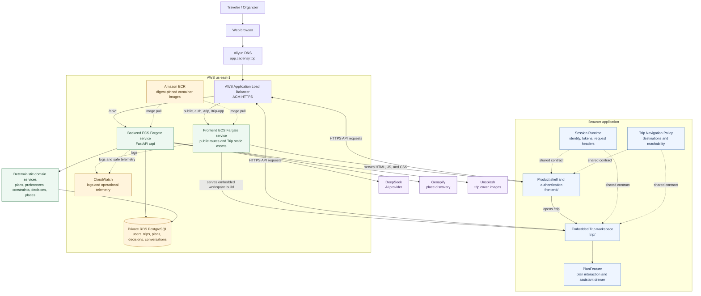
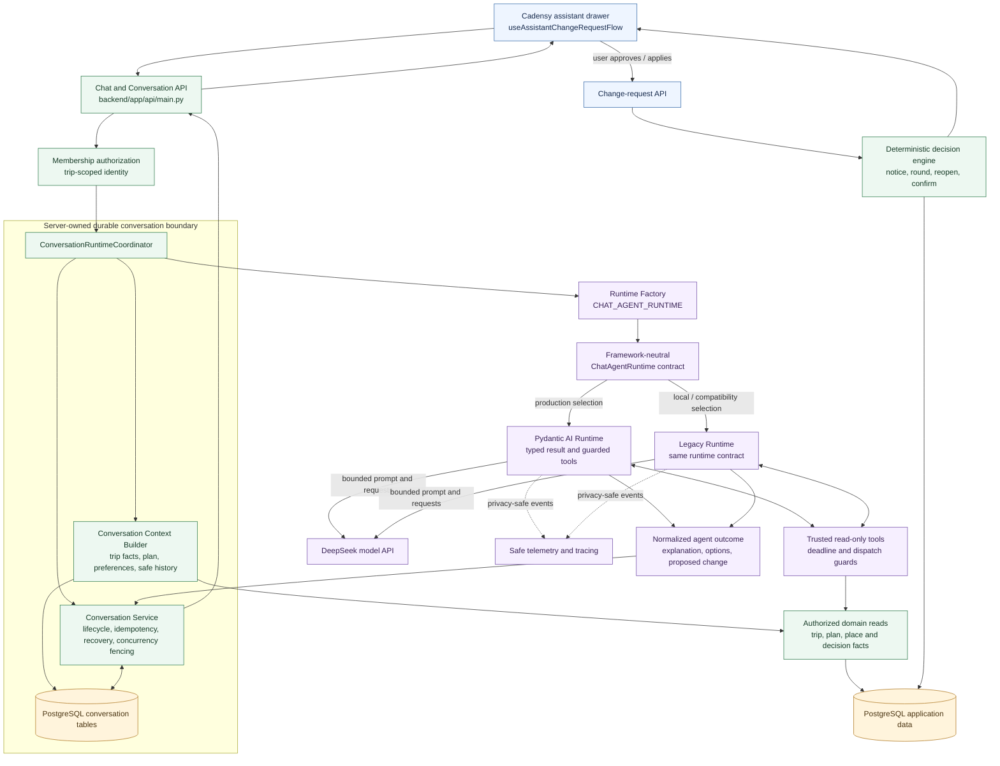

# Cadensy

Cadensy is a group travel planning web app for turning everyone's preferences into one shared itinerary. It supports trip creation, invite-based joining, preference collection, itinerary generation, collaborative plan changes, comments, updates, and member coordination.

The main problem it solves is coordination. Group trips usually involve different budgets, schedules, mobility needs, food preferences, and booking commitments. Cadensy keeps those inputs attached to the plan, so changes can be handled without forcing every small adjustment into a long group chat.

AI is part of the product, but it is not the whole product. It helps explain the itinerary, generate or repair plan options, and turn natural-language requests into structured changes. The final decision path is handled by product rules, so the system can stay predictable and auditable.

## Capstone Documentation

The current in-repository development record starts at
[`docs/README.md`](./docs/README.md). Use it to distinguish active contracts,
point-in-time evidence, and archived material. The current operational summary
is [`HANDOFF.md`](./HANDOFF.md).

The final capstone documentation is maintained on the `docs` branch:

- [Cadensy full-stack system documentation](https://github.com/shnnzdx/cap_stone/blob/docs/docs/Cadensy_Full_Stack_System_Documentation.md)
- [Docs folder entry point](https://github.com/shnnzdx/cap_stone/tree/docs/docs)

That submission document contains production support, setup instructions, issue diagnosis records, user guidance, architecture diagrams, deployment notes, testing evidence, and security considerations.

## What The App Does

Cadensy currently supports:

- account signup and login
- trip creation with destination, dates, and group size
- invite links for account members and guests
- member preference collection
- private and visible planning requirements
- itinerary generation from trip facts and place candidates
- a current-plan workspace with map, daily agenda, comments, and history
- natural-language plan edits through the Cadensy assistant drawer
- anonymous notices, group voting rounds, and affected-member confirmations
- organizer tools for reminders, round extensions, and deadlock handling

## Product Rules

The product has a few non-negotiable rules:

- One shared plan is the source of truth.
- Organizers do not get a stronger vote than other members.
- Private requirement wording should not be shown to the group.
- Booked items and hard requirements are harder to move than loose ideas.
- Every meaningful plan change should leave an auditable trail.

Core decision paths:

| Path | When it happens | Result |
| --- | --- | --- |
| Notice | No conflict and no hard requirement is affected | The change applies and the group gets an anonymous update |
| Round | The slot is contested or overlaps another plan | Members vote on structured options |
| Reopened round | A settled decision is being changed | A stronger group decision is required |
| Confirm | A booking or hard requirement is affected | Every affected member must approve |

For detailed behavior, read [docs/PRODUCT.md](./docs/PRODUCT.md).

## Tech Stack

- Frontend site: React, Vinext/Next, TypeScript/JavaScript, Tailwind CSS
- Trip workspace: React, Vite, React Router, Leaflet
- Backend: Python, FastAPI, SQLAlchemy, PostgreSQL
- Tests: pytest, Node test runner, frontend integration checks
- External data and AI integrations: DeepSeek, Geoapify, Unsplash
- Production runtime: AWS ECS Fargate, ECR, ALB, ACM, CloudWatch, private RDS PostgreSQL, Aliyun DNS for `app.cadensy.top`

## Repository Layout

```text
/
|-- frontend/              Public site, auth pages, and the `/trip` host shell
|-- trip/                  Trip workspace app: plan, chat, updates, members, invites
|-- backend/               FastAPI + PostgreSQL API and domain logic
|-- shared/                Shared route, session, theme, and product contracts
|-- docs/                  Product, handoff, design, and operating notes
|-- AWS/                   Deployment planning and infrastructure notes
|-- AGENTS.md              Working rules for AI agents in this repository
|-- AI.md                  Compatibility pointer for older AI workflows
`-- README.md
```

The codebase currently has two frontend surfaces:

- `frontend/` owns the public website, login/signup pages, and the shell at `/trip`.
- `trip/` owns the embedded Trip workspace app that renders the logged-in planning experience.

The workspace build is copied into `frontend/public/trip-app/` so the main site can embed it.

## Architecture

Production currently runs behind `https://app.cadensy.top`:

### Overall System Architecture



### AI Agent Architecture



The AI runtime can propose and explain a change, but it cannot directly mutate the
current plan. User-approved proposals return through the deterministic decision engine,
which owns validation, voting, confirmation, persistence, and the audit trail. See
[`backend/app/agents/AI_AGENT_SUMMARY.md`](./backend/app/agents/AI_AGENT_SUMMARY.md)
for the implementation map and [`AI_enhanced/README.md`](./AI_enhanced/README.md) for
dated engineering evidence.

### Frontend

- `frontend/app/` renders the public product pages and the `/trip` shell.
- `trip/src/final/FinalApp.jsx` owns workspace routing and screen composition.
- `trip/src/final/TripAppState.jsx` owns trip hydration, polling, API coordination, session state, and action dispatch.
- `trip/src/final/plan-feature/PlanFeature.jsx` owns the Plan workspace feature boundary.
- `trip/src/final/plan-feature/usePlanInteractionRuntime.js` owns plan selection, comments, map/list coordination, menus, and booking UI.
- `trip/src/final/plan-feature/useAssistantChangeRequestFlow.js` owns the Cadensy drawer conversation and change-request flow.

### Backend

- `backend/app/api/main.py` exposes the HTTP API.
- `backend/app/domain/constraints/` classifies hard constraints and decision paths.
- `backend/app/domain/decisions/` executes notice, vote, reopen, and confirmation flows.
- `backend/app/domain/plans/` generates and validates itinerary plans.
- `backend/app/domain/preferences/` stores member preferences and enforceable constraints.
- `backend/app/domain/chat/` handles AI-assisted natural-language trip changes.
- `backend/app/domain/places/` manages place candidates and provider-backed facts.

### Shared Runtime

- `shared/session-runtime/` owns browser session persistence, bearer-token mechanics, invite adoption cache, and request identity headers.
- `shared/trip-navigation-policy/` owns workspace destination policy and route reachability.
- `shared/trip-navigation-route/` owns workspace route serialization.
- `shared/tripsync-preview-contract.js` and `shared/tripsync-preview-theme.css` define the embedded workspace contract.

## Requirements

- Node.js `>= 22.13.0`
- npm
- Python `3.13`
- PostgreSQL

## Use The Cloud Version

Cadensy can be used directly from the deployed AWS environment:

```text
https://app.cadensy.top
```

Useful cloud routes:

- `https://app.cadensy.top` - public site
- `https://app.cadensy.top/login` - login page
- `https://app.cadensy.top/trip` - logged-in trip workspace
- `https://app.cadensy.top/trip-app/index.html` - embedded Trip static entry
- `https://app.cadensy.top/api/health` - backend health check

Use the local setup below only when developing, testing, or debugging the app on your own machine.

## Install

Install frontend dependencies:

```bash
cd frontend
npm install
```

Install Trip workspace dependencies:

```bash
cd trip
npm install
```

Set up the backend:

```bash
cd backend
python -m venv .venv
```

On Windows:

```powershell
.\.venv\Scripts\python.exe -m pip install -r requirements.txt
Copy-Item .env.example .env
```

On macOS or Linux:

```bash
.venv/bin/python -m pip install -r requirements.txt
cp .env.example .env
```

Create the local PostgreSQL databases expected by the default configuration:

```bash
createdb tripsync
createdb tripsync_test
```

Seed local demo data:

```bash
cd backend
python -m app.db.seed
```

The default local login created by the seed is:

```text
email: organizer@cadensy.local
password: 12345678
```

## Run Locally

Start the backend:

```bash
cd backend
python -m uvicorn app.api.main:app --host 127.0.0.1 --port 8000 --reload
```

Open the API docs:

```text
http://127.0.0.1:8000/docs
```

Start the main site:

```bash
cd frontend
npm run dev
```

Default URL:

```text
http://localhost:3000
```

Start the Trip workspace directly:

```bash
cd trip
npm run dev
```

Default URL:

```text
http://localhost:5173
```

Important: the public site can run without the backend, but login and the logged-in `/trip` experience require the backend and a seeded PostgreSQL database.

## Embedded Trip Workspace

The main site embeds the built Trip workspace from `frontend/public/trip-app/`.

After changing files in `trip/`, sync the embedded build:

```bash
cd frontend
npm run build:trip-preview
```

That command:

1. builds `trip/`
2. copies `trip/dist/` into `frontend/public/trip-app/`
3. writes `frontend/public/trip-app/embed-manifest.json`

If `trip/` is already built and you only need to copy the output:

```bash
cd frontend
npm run sync:trip-preview
```

## Main Routes

Public and shell routes:

- `/`
- `/login`
- `/signup`
- `/how-it-works`
- `/faq`
- `/privacy`
- `/trip`
- `/trip-app/`

Workspace hash routes:

- `#/`
- `#/create`
- `#/account/profile`
- `#/account/travel`
- `#/account/notifications`
- `#/account/settings`
- `#/trip/:tripId/plan`
- `#/trip/:tripId/chat`
- `#/trip/:tripId/conflict`
- `#/trip/:tripId/updates`
- `#/trip/:tripId/preferences`
- `#/trip/:tripId/members`
- `#/trip/:tripId/invite`
- `#/join/:token`

## Test And Verify

Submission-critical validation commands:

```bash
cd backend
DISABLE_SCHEDULER=1 MOCK_AI=1 python -m pytest -q
```

```bash
cd frontend
npm test
```

```bash
cd trip
npm run build
```

```bash
cd frontend
npm run build:trip-preview
npm run build
```

Embedded workspace integration check:

```bash
cd frontend
node --test tests/trip-preview-integration.test.mjs
```

Public production smoke check:

```bash
cd frontend
npm run e2e:aws
```

Known note: Vite may print a chunk-size warning. That warning is not currently treated as a build failure.

The capstone documentation records the current testing evidence in detail. The configured frontend submission script, selected backend unit/integration suites, production smoke tests, and manual critical-path workflows are treated as submission-critical validation. Broader legacy backend regression and frontend characterization sweeps are documented as non-blocking maintainer backlog in the `docs` branch submission document.

## Development Notes

- Read [AGENTS.md](./AGENTS.md) before making architecture, session, navigation, or Trip workspace behavior changes.
- Keep frontend decision rendering aligned with backend decision paths. The frontend should submit intent and render the backend result, not reimplement path policy.
- Do not expose private member preference wording in UI or AI explanations.
- When testing `/trip` through the main site, remember that it uses the embedded build under `frontend/public/trip-app/`, not live `trip/src` files.
- Local `.env` files and real API keys should not be committed.

## Related Docs

- [AGENTS.md](./AGENTS.md)
- [AI.md](./AI.md)
- [HANDOFF.md](./HANDOFF.md)
- [INTEGRATION-ROADMAP.md](./INTEGRATION-ROADMAP.md)
- [docs/README.md](./docs/README.md)
- [Capstone submission documentation](https://github.com/shnnzdx/cap_stone/blob/docs/docs/Cadensy_Full_Stack_System_Documentation.md)
- [backend/README.md](./backend/README.md)
- [backend/LOCAL_DEV.md](./backend/LOCAL_DEV.md)
- [frontend/README.md](./frontend/README.md)
- [trip/README.md](./trip/README.md)
- [docs/PRODUCT.md](./docs/PRODUCT.md)
- [docs/HANDOFF_PROMPT_CURRENT.md](./docs/HANDOFF_PROMPT_CURRENT.md)
- [AWS/README.md](./AWS/README.md)
